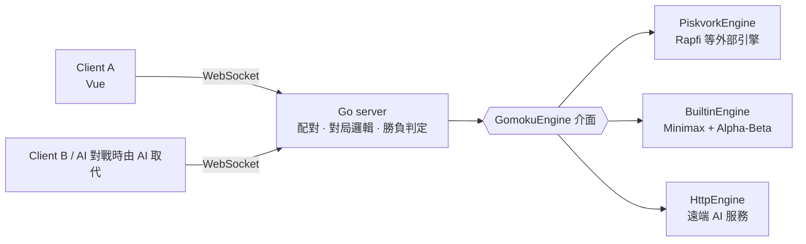

# 五子棋對戰系統規格

> 此檔匯出自 Claude Doc 版本的規格，以該文件為主。

Oct 20, 2026 · @Sam

## 概述

本系統是一套 client-server 架構的五子棋對戰遊戲，支援人人對戰與人機對戰，且 AI 引擎必須可以替換。

| 模式 | 說明 |
| --- | --- |
| 人人對戰 | 兩位玩家各自連線到 server，由 server 配對並轉發棋步 |
| AI 對戰 | 玩家與 server 端的 AI 引擎對弈，引擎可替換 |

## Client 介面

主畫面有三個按鈕：「AI 對戰」、「人人對戰」與「加入房間」，點擊後進入對應模式。

| 按鈕 | 點擊後行為 |
| --- | --- |
| AI 對戰 | 先選擇自己執先手或後手，確認後立即進入棋盤畫面 |
| 人人對戰 | 先選擇自己執先手或後手，確認後停在加入碼畫面，等對手輸入加入碼 |
| 加入房間 | 輸入房主提供的加入碼，成功後進入棋盤畫面，先後手為房主未選的另一方 |

開房設定與加入碼：

- 開房時由房主決定自己執先手或後手，對手取得另一方
- 開房設定旁提供規則勾選項；第一版只做 freestyle，勾選項先不開放，之後再加入禁手規則（Renju）；不提供悔棋
- 人人對戰開房後停在加入碼畫面，顯示加入碼並等待對手加入
- 對手在主畫面點「加入房間」並輸入加入碼後，雙方同時進入棋盤畫面

棋盤畫面需求：

- 15×15 棋盤，點擊交叉點落子
- 顯示目前輪到誰、雙方執子顏色
- 對局結束時顯示勝負結果，並可返回主畫面；對局中可認輸（需按兩次確認）

## 系統架構

Client 透過 WebSocket 連線到 server；server 負責配對、對局邏輯與勝負判定，AI 只經由 GomokuEngine 介面呼叫。



人機對戰時玩家 B 由 AI 取代；三種引擎實作可隨時替換，對局邏輯不需修改。

## AI 引擎

Server 只透過統一的引擎介面與 AI 溝通，不依賴任何特定引擎，更換引擎不需改動對局邏輯。

```ts
interface GomokuEngine {
  start(size: number, rule: 'freestyle' | 'renju'): Promise<void>;
  setPosition(moves: Move[]): Promise<void>;
  think(timeLimitMs: number): Promise<Move>;
  dispose(): Promise<void>;
}
```

| 實作 | 用途 | 溝通方式 |
| --- | --- | --- |
| PiskvorkEngine | 外部引擎，如 [Rapfi](https://github.com/dhbloo/rapfi) 或其他 Gomocup 引擎 | 子程序 stdin/stdout，Piskvork 協議 |
| BuiltinEngine | 內建 Minimax + Alpha-Beta，作為預設與備援 | 同一 process 內呼叫 |
| HttpEngine | 遠端 AI 服務，如 Python 的 AlphaZero 模型 | HTTP API |

Piskvork 協議使用的指令：

- `START 15`：開 15×15 棋盤，引擎回 `OK`
- `BEGIN`：AI 先手，回傳座標 `x,y`
- `TURN x,y`：告知對手棋步，引擎回傳自己的棋步
- `BOARD ... DONE`：送出整盤局面，用於重連或恢復
- `INFO timeout_turn <ms>`：限制每步思考時間
- `END`：結束引擎

## 規則與注意事項

預設採 15×15 棋盤、無禁手（freestyle），黑棋先手，先連成五子者勝。第一版只做 freestyle；之後加入禁手勾選時，黑棋形成三三、四四或長連即判負；若同一手同時形成五連，仍判黑棋勝。

- 落子合法性與勝負一律由 server 判定，client 只負責顯示，防止作弊
- 每場對局使用獨立的引擎實例，或由引擎 pool 管理，避免多局互相干擾
- 引擎每步設 timeout；逾時或崩潰時自動重啟，並以 `BOARD` 恢復局面
- 玩家斷線後可用 token 重連，server 保留座位 60 秒（可設定）；逾時未回，對手以 abandoned 獲勝
- 座標統一採 0-based 的 `x,y`，與 Piskvork 協議一致
- 落子訊息帶 `ply`（client 已看到的手數）；與目前手數不符視為過期並拒絕，雙方幾乎同時落子時只接受輪到的那一方
- 對局中離開房間視為認輸（resign）
- 引擎重啟後仍失敗且內建引擎備援也失敗時，對局以 engine\_error 結束

## 技術選型與開發環境

後端使用 Go，前端使用 Vue。目前只在 Ubuntu 開發機上開發與測試，不區分 dev 與 prod 環境。

開發機為 Ubuntu（192.168.100.100），位於 Tailscale 網路內。

- 監聽埠、引擎種類與路徑、timeout、WebSocket 位址放在設定檔或環境變數，不寫死
- Go 編譯成單一執行檔；Vue build 出的靜態檔可由 Go server 一併提供
- 從 Tailscale 存取時，使用開發機的 Tailscale 位址或 MagicDNS 名稱，192.168.100.x 僅在區網內有效
- 遊戲伺服器監聽 8200 埠（`RENJU_ADDR=:8200`），並以 `RENJU_STATIC_DIR=web/dist` 一併提供前端；WebSocket 位址為同一網址的 `/ws`
- 對外網址：<https://renju.blankmaze.cc>，經 Cloudflare Tunnel（dragonite-OwO）轉到 `localhost:8200`；server 需設 `RENJU_ALLOWED_ORIGINS=renju.blankmaze.cc`

## 開發階段

先把 API 寫好並測過，再做畫面渲染。

1. **階段一：後端 API（Go）— 已完成**
   - WebSocket 協議、房間與加入碼、開房設定（先後手、勾選項）
   - 對局邏輯：驗證落子、判定勝負
   - 引擎介面與內建 Minimax，支援 AI 對戰
   - 驗證方式：單元測試涵蓋勝負判定與落子驗證；整合測試用腳本模擬兩個 client 完成「開房、加入、對下到結束」，另測一局 AI 對戰
2. **階段二：前端畫面（Vue）— 已完成**
   - 主畫面三個按鈕、開房設定、加入碼畫面、棋盤畫面
   - 直接串接階段一已測過的 API
3. **之後再評估**：禁手規則勾選（Renju）、接入 Rapfi 等外部引擎（PiskvorkEngine）

## 階段一測試項目

階段一全部以自動化測試驗證，分四類，通過後才進入階段二。測試以 `go test -race` 執行，確保沒有 data race。

### 對局規則（單元測試）

| 測試項目 | 預期結果 |
| --- | --- |
| 橫、直、兩條斜線各形成五連 | 判定該方獲勝 |
| 六連以上（freestyle） | 判定獲勝 |
| 只有四連 | 不判勝 |
| 五連剛好落在棋盤角落或邊界 | 正確判定獲勝 |
| 落在已有棋子的位置 | 拒絕，棋盤不變 |
| 座標超出 15×15 範圍（含負值） | 拒絕 |
| 輪到對方時落子 | 拒絕 |
| 對局結束後再落子 | 拒絕 |
| 棋盤下滿且無人五連 | 判和局 |
| 黑棋先手；房主選後手時 | 第一手由對手（黑）下 |
| （之後實作）啟用禁手時，黑棋形成三三、四四或長連 | 判黑棋負；若同一手同時形成五連，仍判黑棋勝 |

### 房間與加入碼（API 測試）

| 測試項目 | 預期結果 |
| --- | --- |
| 開房 | 回傳加入碼，房間進入等待狀態 |
| 同時開多個房間 | 加入碼互不重複 |
| 用正確加入碼加入 | 成功，雙方收到開局通知 |
| 用不存在的加入碼加入 | 回傳錯誤訊息 |
| 第三人用已滿房間的加入碼加入 | 拒絕 |
| 房主選先手或後手 | 雙方收到的執子顏色與選擇一致 |
| 開房時的勾選項 | 雙方收到的設定一致 |
| 房主在對手加入前離開 | 房間清除，加入碼失效 |

### 連線與對局流程（整合測試，腳本模擬兩個 client）

| 測試項目 | 預期結果 |
| --- | --- |
| 開房、加入、輪流落子到一方五連 | 雙方都收到勝負結果 |
| 一方落子 | 另一方即時收到同一座標 |
| 送出非法落子 | 只有送出者收到錯誤，棋盤狀態不變，對手不受影響 |
| 雙方幾乎同時送出落子 | 只接受輪到的那一方 |
| 對局中一方斷線 | 另一方收到通知；重連後取得完整局面 |
| 同時進行多局（例如 10 局） | 各局互不干擾 |
| 對局結束 | 房間狀態正確，資源被清理 |

### AI 對戰與引擎介面

| 測試項目 | 預期結果 |
| --- | --- |
| 玩家選先手 | AI 等玩家先下 |
| 玩家選後手 | AI 先下第一步 |
| AI 回傳的棋步 | 一定在棋盤內且是空位 |
| AI 每步思考 | 在設定的 timeout 內回傳 |
| AI 自己有四連 | 下成五連獲勝 |
| 對手有四連 | AI 擋住 |
| AI 對戰完整打完一局 | 正常結束，沒有崩潰 |
| 引擎逾時或崩潰 | 自動重啟並恢復局面，對局繼續 |
| 用假引擎（mock）實作 GomokuEngine 介面 | 不改對局邏輯即可完成一局，驗證引擎可替換 |

## 待決事項

目前沒有待決事項。
